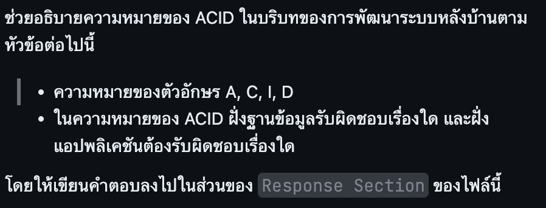

## Question

## Response Section
ACID ในบริบทการพัฒนาระบบหลังบ้าน

ACID คือชุดคุณสมบัติที่รับประกันว่า Transaction  (transaction) ในระบบฐานข้อมูลจะทำงานได้อย่างน่าเชื่อถือ แม้เกิดข้อผิดพลาดหรือมีผู้ใช้หลายคนทำงานพร้อมกัน

ความหมายของตัวอักษร A, C, I, D

A – Atomicity (ความเป็นอะตอม)
Transaction ต้อง "สำเร็จทั้งหมด หรือไม่ทำเลย" ถ้าขั้นตอนใดขั้นตอนหนึ่งล้มเหลว ทุกอย่างที่ทำไปก่อนหน้าจะถูก rollback กลับสู่สถานะเดิม
เช่น SQL statements เรามีทั้งหมด 5 อัน ต้องผ่านทั้งหมดทั้ง 5 statements ถึงจะ commit update/delete ได้ แต่ถ้ามีอันใดอันหนึ่งผิดพลาด
เราจะทำการ rollback ข้อมูลพวกนั้นและไม่ update ขึ้นไป
ตัวอย่าง: โอนเงิน 100 บาทจากบัญชี A ไป B ต้องทั้งหักเงิน A และเพิ่มเงิน B ถ้าหักแล้วแต่เพิ่มไม่สำเร็จ ต้องยกเลิกการหักด้วย

C – Consistency (ความสอดคล้อง)
Transaction ต้องพาข้อมูลจาก "สถานะที่ถูกต้อง" ไปสู่ "สถานะที่ถูกต้องอีกสถานะหนึ่ง" อย่างสอดคล้องกันโดยไม่ละเมิดกฎ (constraint) ของข้อมูล เช่น primary key, foreign key, unique, check constraint
ตัวอย่าง: นาย A มีเงินอยู่ 500 นาย B มีเงิน 300 จากนั้นนาย A โอนเงินให้นาย B 300 บาท 
        ในบัญชีนาย A ต้องมีเงิน -300 เหลือ 200
        ในบัญชีนาย B ต้องมีเงิน +300 กลายเป็น 600

I – Isolation (ความเป็นอิสระต่อกัน)
Transaction ที่ทำงานพร้อมกันต้องไม่รบกวนกัน ผลลัพธ์ควรเหมือนกับการทำทีละรายการต่อเนื่องกัน
ตัวอย่าง: สองคำสั่งตัดสต็อกสินค้าชิ้นสุดท้ายพร้อมกัน ต้องไม่ทำให้ขายได้ทั้งคู่ ต้องทำให้คำสั่งที่เข้ามาใน Process ก่อนสั่งซื้อสำเร็จและคำสั่งซื้อที่เข้ามาทีหลังต้องบอกว่าสินค้าหมดแล้ว

D – Durability (ความคงทน)
เมื่อ Transaction  commit สำเร็จแล้ว ข้อมูลต้องคงอยู่ถาวรจะไม่สามารถเปลี่ยนแปลงได้อีก แม้ระบบล่มหรือไฟดับทันทีหลังจากนั้นก็จะทำอะไรกับ transaction นั้นไม่ได้

ฐานข้อมูลรับผิดชอบอะไร และแอปพลิเคชันรับผิดชอบอะไร

### Atomicity
- ฝั่งฐานข้อมูล: จัดการ commit/rollback และ undo ข้อมูลเมื่อทรานแซกชันล้มเหลว
- ฝั่งแอปพลิเคชัน: กำหนดขอบเขตทรานแซกชันว่าชุดคำสั่งไหนต้องอยู่ด้วยกัน (BEGIN ... COMMIT) สั่ง rollback เมื่อเจอ error และจัดการ error ให้ครบทุกเส้นทาง

### Consistency
- ฝั่งฐานข้อมูล: บังคับใช้ constraint, trigger และ data type ที่ประกาศไว้
- ฝั่งแอปพลิเคชัน: ออกแบบกฎทางธุรกิจที่ constraint ครอบคลุมไม่ถึง (เช่น ยอดอนุมัติลาต้องไม่เกินสิทธิ์) และตรวจสอบข้อมูลนำเข้าก่อนส่งลง DB

### Isolation
- ฐานข้อมูล: จัดการเรื่อง lock และให้เลือกระดับความเข้มงวด (isolation level)
- ฝั่งแอปพลิเคชัน: เลือกระดับที่เหมาะกับงาน ใช้ lock หรือ version ตรวจเมื่อมีโอกาสแก้ข้อมูลชนกัน และ retry เมื่อเกิด deadlock

### Durability
- ฝั่งฐานข้อมูล: เขียน transaction log ลงดิสก์ และกู้ข้อมูลเมื่อระบบล่ม
- ฝั่งแอปพลิเคชัน: ตั้งค่า backup/replication และรอให้ commit สำเร็จก่อนตอบผู้ใช้ ห้ามคิดว่าข้อมูลที่อยู่แค่ใน cache (เช่น Redis) ปลอดภัยแล้ว
