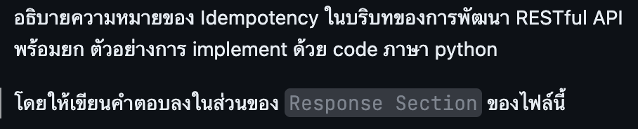

## Question

## Response Section

# Idempotency ในบริบท RESTful API

## ความหมาย

Idempotency คือคุณสมบัติที่ว่า **เรียก request เดิมซ้ำกี่ครั้งก็ตาม ผลที่เกิดกับระบบต้องเหมือนกับเรียกครั้งเดียว**

เหตุผลที่ต้องสนใจ: request อาจถูกส่งซ้ำได้เสมอ เช่น เครือข่ายช้าจน timeout แล้ว client ส่งใหม่ หรือผู้ใช้กดปุ่มซ้ำ ถ้า API ไม่ idempotent จะเกิดปัญหา เช่น ตัดเงินซ้ำ หรือสร้างออเดอร์ซ้ำ

HTTP method ที่ idempotent อยู่แล้ว: GET, PUT, DELETE
HTTP method ที่ไม่ idempotent โดยธรรมชาติ: POST (ส่งซ้ำ = สร้างซ้ำ) จึงต้องออกแบบเพิ่ม เช่น ใช้ `Idempotency-Key`

## ตัวอย่างการ implement (Python / FastAPI)

หลักการ: client ส่ง `Idempotency-Key` มาใน header ถ้า server เจอ key เดิมจะไม่ทำงานซ้ำ แต่ส่งผลลัพธ์เดิมกลับไป

```python
import hashlib
import threading
import uuid

from fastapi import FastAPI, Header, HTTPException
from pydantic import BaseModel

app = FastAPI()

payments = {}           # payment_id -> ข้อมูลการชำระเงิน
idempotency_store = {}  # key -> {request_hash, response}
lock = threading.Lock()


class PaymentIn(BaseModel):
    user_id: int
    amount: float


@app.post("/payments", status_code=201)
def create_payment(body: PaymentIn, idempotency_key: str = Header(...)):
    request_hash = hashlib.sha256(body.model_dump_json().encode()).hexdigest()

    with lock:
        saved = idempotency_store.get(idempotency_key)

        if saved:
            # key เดิมแต่ body ต่างไป = ใช้ key ผิด
            if saved["request_hash"] != request_hash:
                raise HTTPException(422, "Idempotency-Key นี้ถูกใช้กับข้อมูลชุดอื่นแล้ว")
            # key เดิม body เดิม = ส่งผลลัพธ์เดิมกลับ ไม่ทำซ้ำ
            return saved["response"]

        # key ใหม่ = ทำงานจริง
        payment = {
            "id": str(uuid.uuid4()),
            "user_id": body.user_id,
            "amount": body.amount,
            "status": "paid",
        }
        payments[payment["id"]] = payment
        idempotency_store[idempotency_key] = {
            "request_hash": request_hash,
            "response": payment,
        }

    return payment
```

เมื่อ Client ส่งคำขอแรกพร้อม Header Idempotency-Key: abc-123 ระบบจะสร้างรายการชำระเงินและเก็บผลลัพธ์ไว้คู่กับ payload_hash
หากเครือข่ายมีปัญหาแล้ว Client ส่งคำขอเดิมด้วย Idempotency-Key: abc-123 ซ้ำอีกครั้ง ระบบจะตรวจพบว่าเคยทำไปแล้วและคืนผลลัพธ์เดิมกลับไปทันที โดยไม่สร้างรายการหรือตัดเงินซ้ำ